# kb2pad-dock

**Juega en tu PC juegos de celular que no existen para PC y que no tienen soporte de teclado.**

El juego corre en tu celular Android, tal cual lo instalaste de la Play Store. Tu PC funciona
como un *dock*: muestra la pantalla con [scrcpy](https://github.com/Genymobile/scrcpy) y
convierte tu teclado y mouse en un **control de Xbox 360 virtual**. El juego ve un control
real, no toques falsos.

Funciona en **Linux** y **Windows**, desde la misma app y con el mismo archivo de configuración.

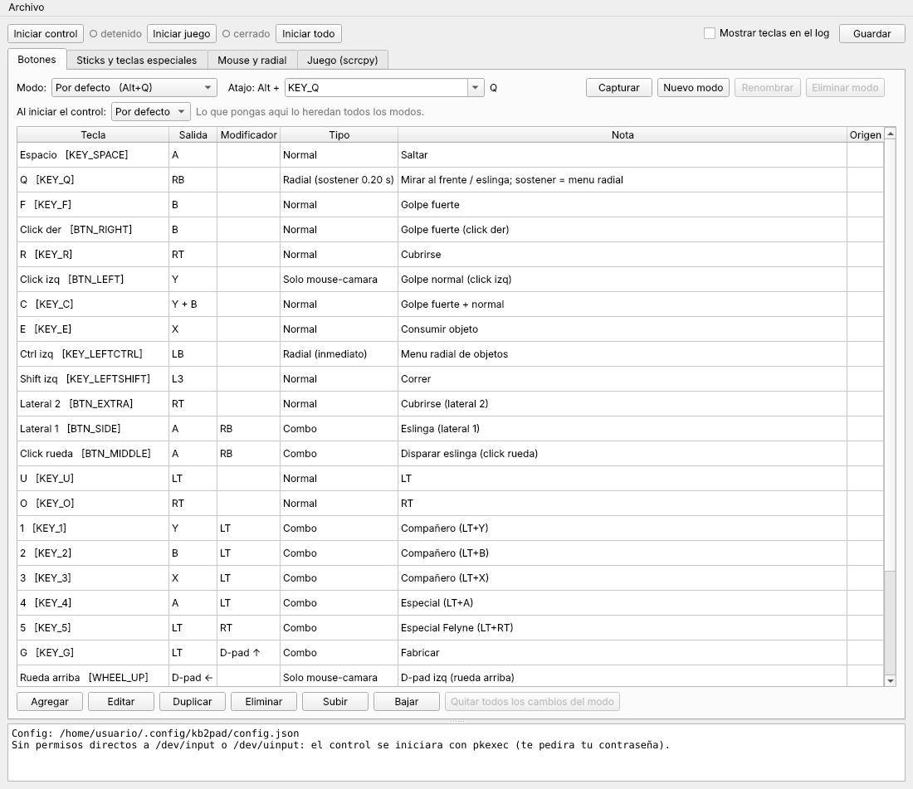

---

## ¿Para qué sirve?

Hay juegos de celular que:

- **no tienen versión de PC** ni de consola,
- **no se dejan emular**: la Play Store marca el emulador como "no compatible" o el juego
  revisa que lo hayas instalado desde la tienda,
- y **no aceptan teclado y mouse**, aunque **sí aceptan un control**.

kb2pad-dock resuelve justo eso: el juego no se toca y corre nativo en tu celular, y en la PC
juegas con teclado y mouse en una ventana sin bordes del tamaño de tu monitor, incluso con la
pantalla del celular apagada.

Nació para jugar **Monster Hunter Outlanders** (solo para celular) desde la PC, pero sirve
para cualquier juego de Android que acepte control.

## Cómo funciona

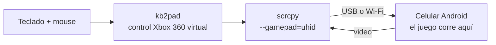

1. **kb2pad** lee tu teclado y mouse y los convierte en un control de Xbox 360 virtual
   (`uinput` en Linux, driver **ViGEmBus** en Windows).
2. **scrcpy** detecta ese control y se lo pasa al celular como un control físico conectado.
3. El juego lo reconoce como cualquier control: muestra los íconos de botones (A, B, LT...).

## Características

- **Modos por estilo de juego** (espada, ballesta, arco) que cambias en plena partida con
  `Alt + tecla`. Cada modo es una plantilla completa que configuras como quieras.
- **Icono del modo en la bandeja del sistema** (espada, ballesta o arco), así sabes en qué modo
  estás sin avisos que tapen el juego. Los iconos se pueden cambiar por una imagen tuya.
- **Mapeo editable desde la app**: tabla de asignaciones con captura de teclas y botones del
  mouse (incluye los laterales de un mouse gamer).
- **Combos con modificador**: una tecla manda `LT` y luego `B`, para menús tipo "LT + botón".
  También con el D-pad (por ejemplo `LT + D-pad ↑`).
- **Varias salidas en una tecla**: por ejemplo `C` = `Y + B`.
- **Mouse como cámara** (stick derecho) que se activa y desactiva con Bloq Mayús. Mientras está
  activo, el cursor se oculta sobre el juego.
- **La rueda del mouse** también se puede asignar (por defecto, D-pad ← / →).
- **Menú radial con el mouse**: mientras sostienes la tecla, el mouse apunta y se queda en el
  objeto; al soltar, lo selecciona.
- **Tocar o sostener**: la misma tecla puede ser un botón normal si la tocas y abrir el radial si
  la sostienes.
- **Cambios en caliente**: guardas y el control aplica el mapeo al momento, sin reiniciar.
- **Modo chat** (`Alt + T`): el teclado deja de ser control y escribe en el celular; el mouse
  sigue igual. Regresas con `Alt + 1/2/3` o `Alt + Q`.
- **Lanza el juego por ti**: al iniciar te pregunta si abrir una app (con buscador entre las apps
  instaladas) o solo mostrar la pantalla. Espera a que el celular gire a horizontal y abre la
  ventana sin bordes.
- **La ventana ocupa toda la pantalla cada vez que el celular pasa a horizontal**, aunque salgas
  del juego y vuelvas; no hace falta reconectar.
- **Modo red (Wi-Fi)**: juega sin cable; se activa con un botón (o emparejando en Android 11+).
- **Menos retraso de video**: elige el codificador del celular, la resolución máxima y, opcional,
  las opciones de baja latencia de cada fabricante (Qualcomm, MediaTek...) con un botón que detecta
  tu chip.
- **Perfiles de video** (Mejor calidad, Balanceado, Rendimiento, Máximo rendimiento) y `Alt + P`
  para alternar entre dos en plena partida.
- **Temperatura del celular**: HUD encima del juego con temperatura, batería, FPS, perfil y modo;
  icono con la temperatura en la bandeja; notificación al llegar a crítico y, en peligro, cierra la
  transmisión (o lo que elijas).
- **Pantalla del celular apagada** mientras juegas (ver las guías).
- Con **Alt presionado** no se manda nada al juego: `Alt+Tab` y los atajos de scrcpy (`Alt+O`)
  no disparan botones.

## Capturas

| Linux | Windows |
|---|---|
|  | 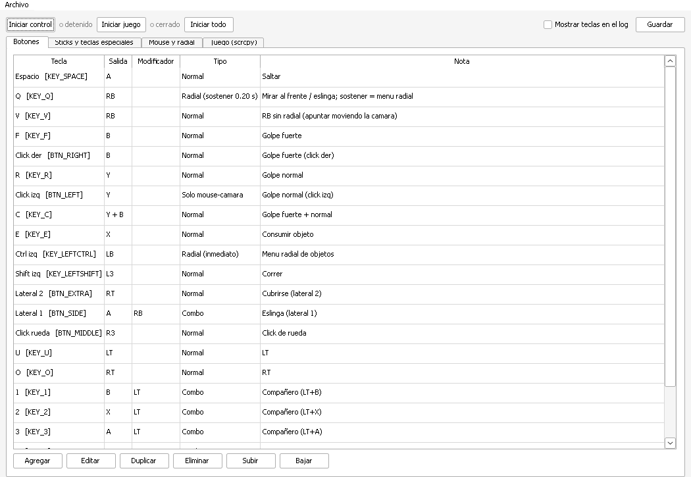 |
| 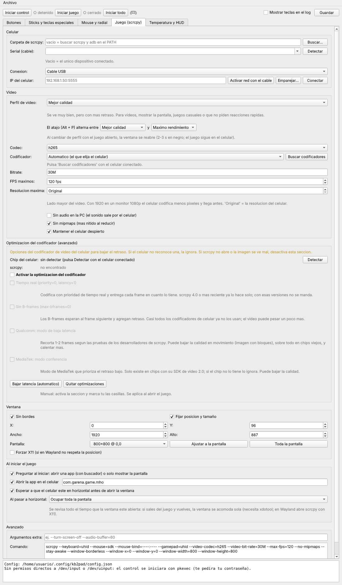 | 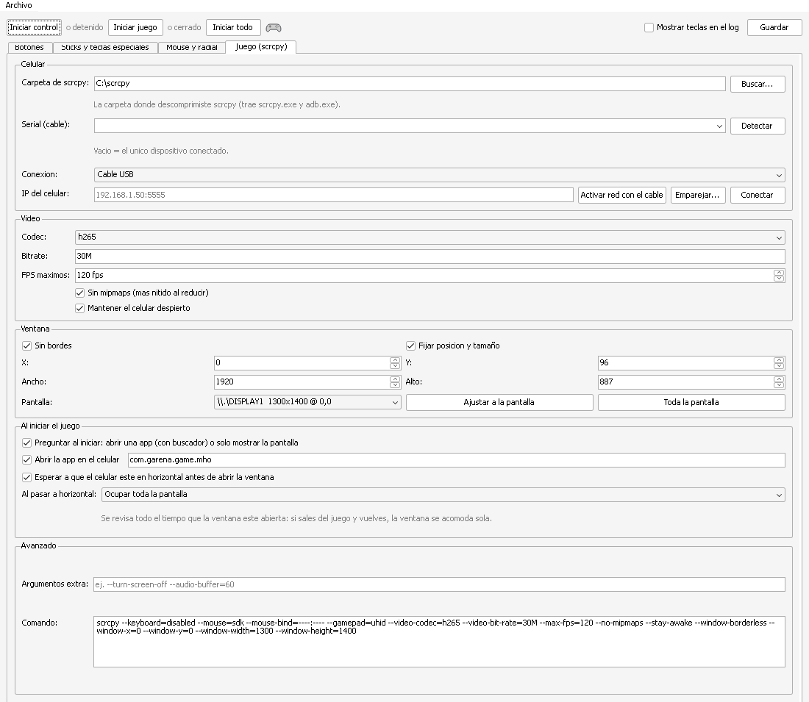 |

| Modo Ballesta | Combo con modificador (LT + X) |
|---|---|
| 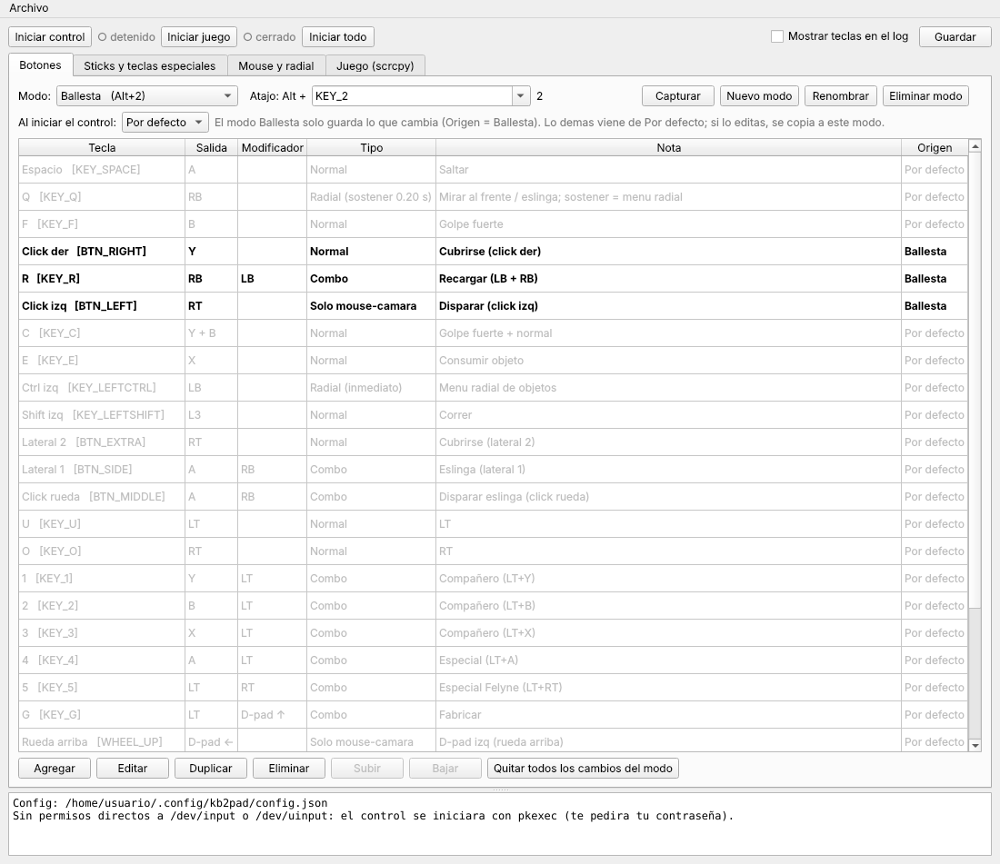 | 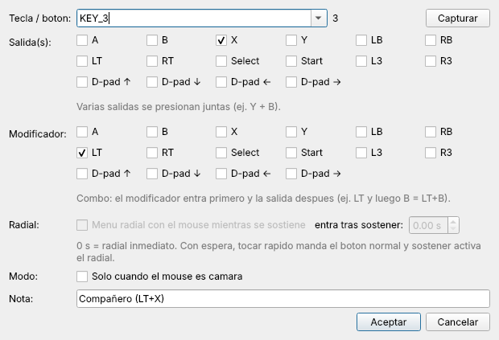 |

| Mouse y menú radial | Sticks y teclas especiales |
|---|---|
| 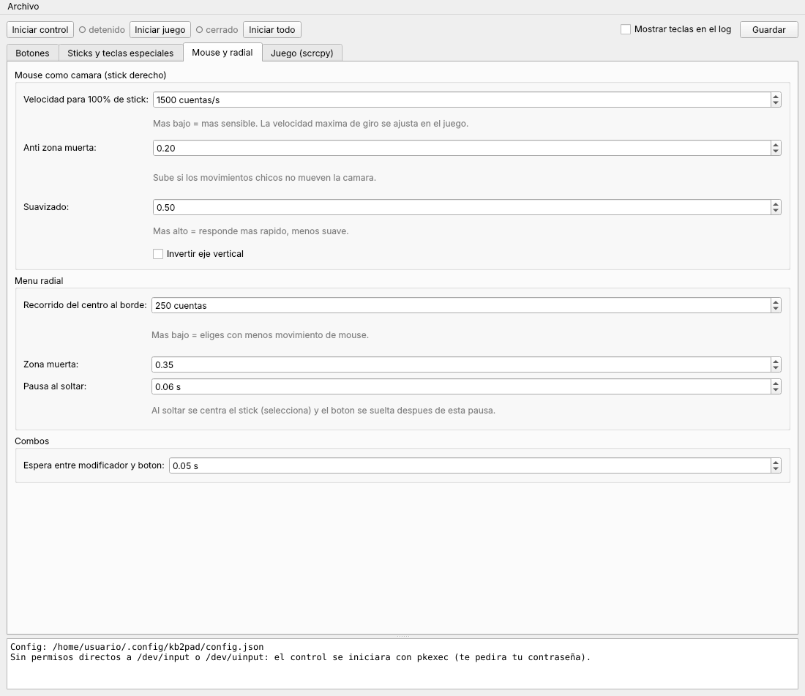 | 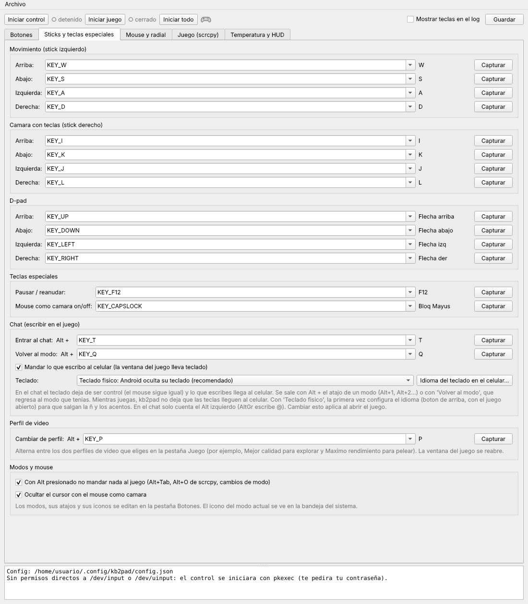 |

| Asignación con menú radial (tocar / sostener) |
|---|
| 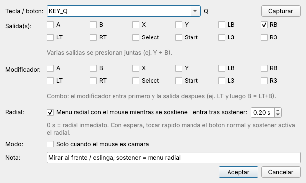 |

## Descargas

En **[Releases](https://github.com/cHeRaZ-edu/kb2pad-dock/releases)**:

| Archivo | Para |
|---|---|
| `kb2pad-dock-v0.4.0-windows-x64.zip` | Windows 10/11 de 64 bits: trae `kb2pad.exe`, no necesitas Python |
| `kb2pad-dock-v0.4.0-linux.tar.gz` | Linux: el código, se corre con Python |

## Guías paso a paso

- 🪟 **[Windows](docs/guia-windows.md)**: instalación, configuración, jugar y apagar la pantalla del celular.
- 🐧 **[Linux](docs/guia-linux.md)**: lo mismo para Linux (probado en CachyOS / Arch).

## Requisitos

- Un celular **Android** con **depuración USB** activada, conectado por USB o por Wi-Fi.
- El juego debe **aceptar control** (gamepad).
- **scrcpy 2.7 o más reciente** (es la versión que trae el soporte de control `--gamepad=uhid`).
  Con scrcpy 3.0 o más reciente la lista de apps al iniciar muestra los nombres; antes, solo los paquetes.
- **Windows**: el driver **ViGEmBus**. El instalador va incluido en la app (*Archivo → Instalar ViGEmBus*).
- **Linux**: Python 3 con PyQt6 y python-evdev.

## Controles por defecto

Esta es la plantilla **Espada** tal como viene; las otras plantillas parten de ella (ver
[Modos](#modos)). Todo se cambia desde la pestaña **Botones** de la app. Las acciones son las de
Monster Hunter Outlanders, como ejemplo. En los combos (`LT + B`), el primer botón entra primero y el segundo
50 ms después, como cuando lo haces en un control.

| Tecla / botón | Control | Ejemplo en el juego |
|---|---|---|
| `W A S D` | Stick izquierdo | Moverse |
| Mouse (con `Bloq Mayús`) | Stick derecho | Cámara |
| `I J K L` | Stick derecho | Cámara con teclas |
| Flechas | D-pad | |
| `Espacio` | A | Saltar |
| Click izquierdo* | Y | Golpe normal |
| `F` / click derecho | B | Golpe fuerte |
| `C` | Y + B (juntos) | Golpe fuerte + normal |
| `R` / lateral 2 / `O` | RT | Cubrirse |
| `E` | X | Consumir objeto |
| `Ctrl` | LB + menú radial con el mouse | Menú de objetos |
| `Q` | RB al tocar / RB + menú radial al sostener | Mirar al frente, eslinga |
| Lateral 1 / click de rueda | RB + A | Eslinga |
| `U` | LT | |
| `1` `2` `3` | LT + Y / B / X | Compañeros |
| `4` | LT + A | Especial |
| `5` | RT + LT | Especial Felyne |
| `G` | D-pad ↑ + LT | Fabricar |
| Rueda del mouse* | D-pad ← (arriba) / D-pad → (abajo) | |
| `T` | B + RB | Preparar trampa |
| `Shift` | L3 | Correr |
| `M` / `Esc` | Select / Start | |
| `F12` | Pausar o reanudar kb2pad | Para escribir en otras apps |
| `Bloq Mayús` | Mouse como cámara sí/no | |
| `Alt + T` | Modo chat (el teclado escribe en el celular) | Chat del juego |
| `Alt + Q` | Volver: del chat al modo que tenías; fuera del chat, al modo de inicio | |
| `Alt + P` | Alternar entre dos perfiles de video (la ventana del juego se reabre) | Explorar con calidad, pelear con rendimiento |

\* El click izquierdo y la rueda solo cuentan como botón con el mouse en modo cámara. Fuera de
ese modo, el mouse funciona normal en la ventana (clics y scroll en los menús). Cada muesca de la
rueda es un toque del D-pad.

## Modos

Cada arma se juega distinto, así que en vez de cambiar teclas a cada rato hay **modos**. Cada
modo es una **plantilla completa**: puedes cambiar cualquier tecla en cualquiera. Vienen con estos
valores por defecto (las teclas que no se usan en combate son iguales en las tres):

| Atajo | Modo | Icono | Qué cambia respecto a la tabla de arriba |
|---|---|---|---|
| `Alt + 1` | **Espada** |  | Nada: es la tabla de arriba (armas cuerpo a cuerpo). |
| `Alt + 2` | **Ballesta** |  | Click izq = RT (disparar) · Click der = Y (cubrirse) · `R` = LT + RB (recargar) · `V` = B (modo misil). `C` sigue siendo Y + B. |
| `Alt + 3` | **Arco** |  | Click izq = RT (disparar) · Click der = Y · `R` = Y. `F` = B y `C` = Y + B siguen igual. |

- Cambias de modo **en plena partida**, sin soltar lo que tienes presionado (sigues corriendo).
- El **icono del modo** se ve en la bandeja del sistema y en la barra de la app. Sale en gris
  cuando el control está detenido o en pausa.
- En la pestaña **Botones** eliges el modo arriba y editas su tabla. Ahí mismo:
  - **Icono**: cambia el dibujo (mando, espada, ballesta, arco, letra) o usa una imagen tuya
    (PNG, SVG o ICO).
  - **Nuevo modo** crea uno copiando el modo actual; le pones su `Alt + tecla`.
  - **Copiar a todos los modos** pone la tecla seleccionada igual en los demás (por ejemplo, si
    cambias `G` = fabricar).
  - **Restaurar plantilla** regresa Espada, Ballesta o Arco a sus teclas de fábrica.
  - **Al iniciar el control** elige con qué modo arranca.


## Chat

Para escribir en el chat del juego sin que las letras disparen botones:

1. Abre el chat en el juego (con el mouse o con su botón).
2. Presiona **`Alt + T`**. El icono de la bandeja cambia a un **teclado** y lo que escribes llega
   al celular. El mouse sigue funcionando como control.
3. Para volver a jugar: **`Alt + 1/2/3`** (ese modo) o **`Alt + Q`** (el modo que tenías).

Se escribe en la **misma ventana del juego**. scrcpy la abre con teclado, y el celular lo ve como un
**teclado físico**, así que Android **no muestra su teclado en pantalla**. Mientras juegas, kb2pad se
traga las teclas antes de que lleguen a esa ventana: solo pasan en el chat y con `Alt` presionado
(`Alt + Tab`, `Alt + O`; con Alt, scrcpy no le manda nada al celular). En otras ventanas escribes
normal.

- **La primera vez**, con el juego abierto, en *Sticks y teclas especiales* pulsa **Idioma del
  teclado en el celular...** y en el celular elige el teclado **scrcpy** → *Español
  (Latinoamérica)* (o el de tu teclado), para que salgan la `ñ` y los acentos.
- Si prefieres el teclado del celular en pantalla, cámbialo en *Teclado* (misma pestaña).
- En Linux necesita `xdotool` (para saber cuándo el juego tiene el foco); sin él, la ventana se abre
  sin teclado y el chat no escribe.
- En el chat solo cuenta el **Alt izquierdo**, porque `AltGr + Q` escribe `@`.

## Iniciar el juego

Con **Iniciar juego** (o **Iniciar todo**) la app pregunta qué hacer:

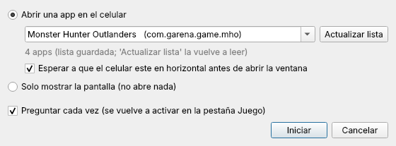

- **Abrir una app**: escribe para buscar entre las apps instaladas (nombre o paquete).
  *Actualizar lista* la vuelve a leer del celular.
- **Solo mostrar la pantalla**: abre la ventana sin abrir nada en el celular.

La elección se recuerda para la próxima vez. Si quitas *Preguntar cada vez*, se vuelve a activar en
la pestaña **Juego (scrcpy)**.

En *Al pasar a horizontal* eliges qué hace la ventana cada vez que el celular gira: **ocupar toda la
pantalla** (por defecto, el video queda centrado con barras negras), usar la posición y el tamaño
fijos, o no tocarla.

## Modo red (Wi-Fi)

En la pestaña **Juego (scrcpy)**, *Conexión* = **Red (Wi-Fi)**:

- **Activar red con el cable**: con el celular conectado por USB, activa adb por Wi-Fi, lee la IP
  y se conecta. Después puedes quitar el cable.
- **Emparejar...** (Android 11+): *Opciones de desarrollador → Depuración inalámbrica → Vincular
  dispositivo con código*, sin cable.
- Al iniciar el juego, la app se conecta sola a esa IP.

El video por Wi-Fi tiene más retraso que por cable: usa una red de 5 GHz y baja el bitrate a 8M–16M.
Si el celular se reinicia, hay que volver a activar la red.

## Bajar el retraso del video

Casi todo el retraso que se siente es del **video** (el celular codifica, la PC decodifica y
dibuja), no del control. En la pestaña **Juego (scrcpy)** → *Video*:

| Opción | Qué hacer |
|---|---|
| **Codec** | `h264` suele llegar antes que `h265`: la PC decodifica con el procesador y H.264 pesa menos. |
| **Codificador** | *Buscar codificadores* lee los de tu celular. Usa uno de **hardware** (por ejemplo `c2.qti.avc.encoder`); evita los de software (`c2.android…`). *Automático* deja que el celular elija. |
| **Resolución máxima** | `1920` en un monitor 1080p: el celular codifica muchos menos píxeles. |
| **Bitrate** | 16M alcanza con 1920 de ancho. |
| **Sin audio** | Libera un poco de procesador en los dos lados; el sonido sale por el celular. |

### Optimización del codificador (avanzado)

Viene **apagada**. Son opciones que se le pasan al codificador de video del celular:

| Opción | Para | Qué hace |
|---|---|---|
| Tiempo real (`priority=0`, `latency=1`) | Cualquier chip | Solo con scrcpy anterior a 4.0; las versiones nuevas ya lo hacen. |
| Sin B-frames (`max-bframes=0`) | Cualquier chip | Quita frames que esperan al siguiente. Casi todos los celulares ya no los usan. |
| Modo de baja latencia (`vendor.qti-ext-enc-low-latency.enable=1`) | Qualcomm | Recorta 1–2 frames en las pruebas de los desarrolladores de scrcpy. **Puede bajar la calidad en movimiento.** |
| Modo conferencia (`mtk.ext.venc.scenario.based.sdk.mode=1`) | MediaTek | Prioriza el retraso bajo; solo en chips con su SDK de video 2.0. **Puede bajar la calidad.** |

Samsung Exynos, Google Tensor, Unisoc y Kirin no tienen una opción pública de baja latencia; para
ellos solo aplican las comunes.

**Bajar latencia (automático)** detecta el chip y tu versión de scrcpy, marca lo recomendado y te
muestra qué va a cambiar, con sus advertencias, antes de aplicarlo. También puedes activar la
sección y marcar las casillas a mano. Si el celular no reconoce una opción, la ignora. Si scrcpy
no abre o la imagen se ve mal, pulsa **Quitar optimizaciones**.

### Perfiles de video

Arriba de la sección *Video* eliges un perfil y llena los campos de un jalón:

| Perfil | Qué pone | Para |
|---|---|---|
| **Mejor calidad** | h265, resolución original, 30M | Se ve muy bien pero con más retraso: videos, mostrar la pantalla, juegos casuales |
| **Balanceado** | h265, 1920 px, 20M | La mayoría de los juegos sin combates exigentes |
| **Rendimiento** | h264, 1920 px, 16M, sin opciones avanzadas | Juegos de acción |
| **Máximo rendimiento** ⚠ | h264, 1920 px, 8M, codificador de hardware y las optimizaciones de tu chip | El menor retraso; el celular trabaja y se calienta más |

`Alt + P` alterna entre dos perfiles que eliges (por defecto Mejor calidad y Máximo rendimiento).
Con el juego abierto, la ventana se reabre (2–3 s en negro; el juego sigue en el celular).

**Advertencia de seguridad**: la primera vez en cada sesión que activas Máximo rendimiento o las
opciones del codificador, sale una advertencia que no se puede aceptar hasta pasados 8 segundos.
Después, en esa misma sesión, ya no interrumpe (para que `Alt + P` no te pare en un combate).

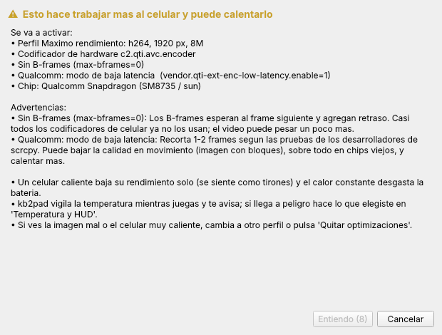

**Para medir**: graba en cámara lenta con otro celular el monitor y el celular juntos, presiona una
tecla y cuenta los frames de diferencia antes y después de cada cambio.

## Temperatura y HUD

Mientras el juego está abierto, kb2pad lee la temperatura del celular con adb cada 5 s
(`dumpsys thermalservice` y `dumpsys battery`). Cuenta la de la **piel** o la **batería** (la más
alta) y el estado térmico de Android; la del CPU se muestra, pero sube a 70–80 °C en juegos y es normal.

| Nivel | Por defecto | Qué pasa |
|---|---|---|
| Aviso | 42 °C o Android en *moderado* | HUD, barra de la app e icono de la bandeja en amarillo |
| Crítico | 46 °C o *severo* | Naranja + **una notificación del sistema** (máximo cada 10 min) |
| Peligro | 50 °C o *crítico* | Rojo + **notificación de peligro** y, si sigue así dos lecturas, **cierra la transmisión** (o la transmisión y el juego, o solo avisa) |

- **HUD**: un cuadro chico encima del juego con temperatura, batería, FPS del video, perfil y modo.
  No recibe clics ni toma el foco. Eliges la esquina, y se activa o apaga desde el menú del icono de
  la bandeja. En Linux con Wayland se dibuja con X11 (XWayland) para poder ir encima del juego.
- **Icono de temperatura** en la bandeja, con el número y el color del nivel.
- Todo se ajusta en la pestaña **Temperatura y HUD**.

Lo que más calienta el celular es el juego: bajar sus FPS en sus ajustes ayuda más que bajar la
calidad del video.

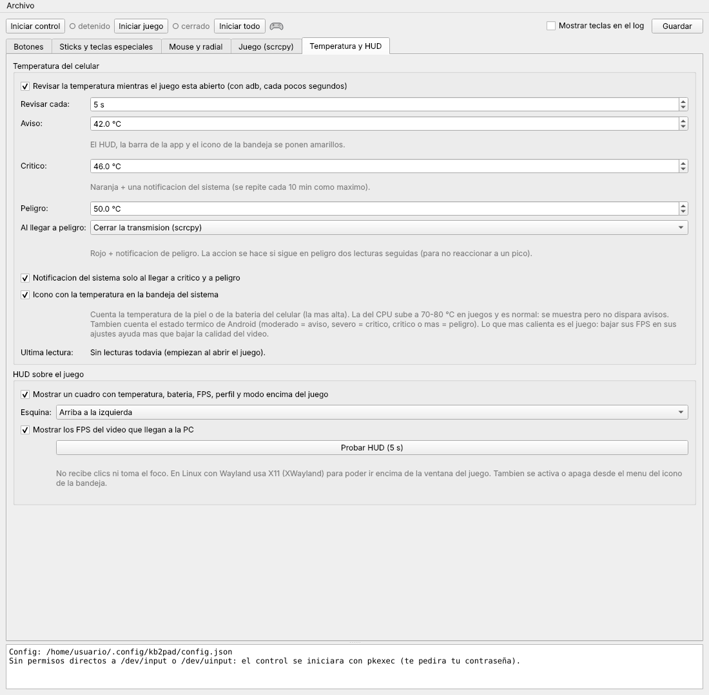

## Notas

- **No modifica el juego** ni inyecta toques: solo hay un control conectado. Aun así, evita
  macros o automatizar acciones en juegos en línea.
- kb2pad lee el teclado **de forma global** mientras está activo. Pausa con `F12` si vas a
  escribir en otra ventana (`Alt + Tab` no manda nada al juego).
- **Xiaomi / POCO / Redmi**: para que el mouse funcione en los menús, activa
  *Depuración USB (Configuración de seguridad)* (viene en las guías).
- **Windows**: el `.exe` no está firmado, así que SmartScreen puede advertir la primera vez.

## Estructura del proyecto

| Archivo | Qué hace |
|---|---|
| `app.py` | La GUI (PyQt6). Es lo que abres. |
| `core.py` | La lógica del mapeo: combos, radial, mouse-cámara. Es la misma en los dos sistemas. |
| `engine.py` | El control virtual en Linux (`evdev` / `uinput`). |
| `engine_win.py` | El control virtual en Windows (ViGEmBus + hooks de teclado y mouse). |
| `config.py` | Valores por defecto, carga, guardado y validación del `config.json`. |
| `keycodes.py`, `_ecodes_data.py` | Códigos de teclas (nombres de evdev en los dos sistemas). |
| `platform_tools.py` | adb, rotación del celular y manejo de la ventana de scrcpy según el sistema. |
| `thermal.py` | Lee y clasifica la temperatura del celular (`dumpsys thermalservice` / `battery`). |
| `hud.py` | El HUD encima del juego (proceso aparte: `app.py --hud`). |
| `icons.py` | Iconos de los modos y de la temperatura, dibujados con QPainter. |
| `kb2pad.spec`, `vigem/` | Build de Windows (PyInstaller) y el cliente/instalador de ViGEmBus. |

La configuración se guarda en:

- Linux: `~/.config/kb2pad/config.json`
- Windows: `%APPDATA%\kb2pad\config.json`

El formato es el mismo, así que puedes copiarla de un sistema a otro.

## Compilar desde el código

**Linux** (no se compila, se corre):

```fish
sudo pacman -S --needed python-pyqt6 python-evdev scrcpy android-tools xdotool
python app.py
```

**Windows** (`.exe` con PyInstaller):

```bat
pip install -r requirements.txt pyinstaller
python -m PyInstaller --noconfirm kb2pad.spec
```

El resultado queda en `dist\kb2pad\kb2pad.exe`.

## Créditos

- [scrcpy](https://github.com/Genymobile/scrcpy) de Genymobile: el puente con el celular.
- [ViGEmBus / ViGEmClient](https://github.com/nefarius/ViGEmBus) de Nefarius: el control virtual en Windows.
- [vgamepad](https://github.com/yannbouteiller/vgamepad): de ahí viene el cliente de ViGEm incluido.
- [PyQt6](https://www.riverbankcomputing.com/software/pyqt/) y [python-evdev](https://github.com/gvalkov/python-evdev).

## Licencia

El código de kb2pad-dock está bajo licencia [MIT](LICENSE). El `.exe` de Windows incluye
componentes de terceros con sus propias licencias (entre ellas PyQt6, GPL-3.0); el detalle está
en [THIRD_PARTY_NOTICES.md](THIRD_PARTY_NOTICES.md).

kb2pad-dock no está afiliado a Capcom, TiMi Studio Group, Garena ni Genymobile. Los nombres de
juegos se mencionan solo como ejemplo de uso.
