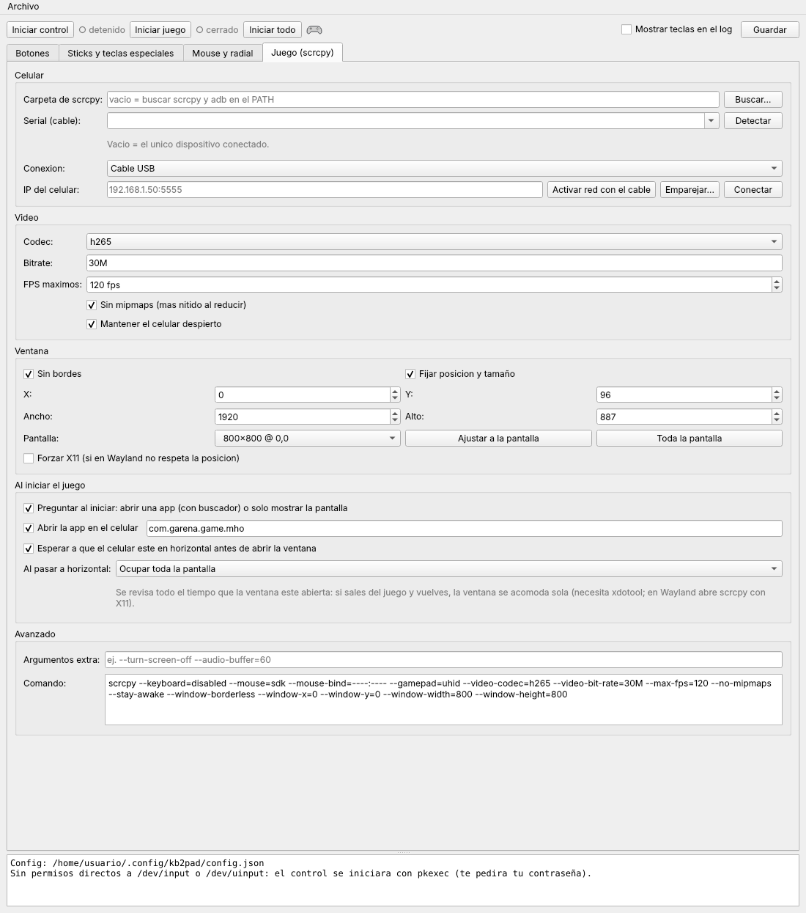

# Guía paso a paso: Linux

Al terminar vas a jugar en tu PC con teclado y mouse, el juego corriendo en tu celular y la
pantalla del celular apagada.

Probado en **CachyOS / Arch** con KDE Plasma (Wayland). En otras distribuciones los pasos son los
mismos; solo cambian los nombres de los paquetes.

**Necesitas:** un celular Android, un cable USB de datos (no solo de carga) y un juego que acepte
control.

---

## Parte 1. Preparar el celular (una sola vez)

1. **Activa las opciones de desarrollador.**
   Ajustes → *Acerca del teléfono* → toca 7 veces *Número de compilación*.
   En Xiaomi, POCO y Redmi es *Versión de HyperOS* (o *Versión de MIUI*).
2. **Activa la depuración USB.**
   Ajustes → *Opciones de desarrollador* → *Depuración USB*.
   En Xiaomi está en Ajustes → *Ajustes adicionales* → *Opciones de desarrollador*.
3. **Solo Xiaomi, POCO y Redmi:** en esa misma pantalla activa también
   **Depuración USB (Configuración de seguridad)**.
   - Te pide iniciar sesión con tu cuenta Xiaomi y, a veces, tener SIM y datos activos.
   - Reinicia el celular después de activarla.
   - Sin esta opción el mouse no puede tocar en los menús y el log muestra un error de
     `INJECT_EVENTS`.
4. **Instala el juego** desde la Play Store del celular y ábrelo una vez para que termine de
   descargar sus datos.
5. **Conecta el celular por USB** a la PC. En el celular, en la notificación de USB, elige
   *Transferencia de archivos*. Cuando aparezca **"¿Permitir depuración USB?"**, marca
   *Permitir siempre desde esta computadora* y acepta.

## Parte 2. Instalar en la PC (una sola vez)

1. **Instala las dependencias.**

   CachyOS / Arch:
   ```fish
   sudo pacman -S --needed python-pyqt6 python-evdev scrcpy android-tools xdotool
   ```
   En Debian, Ubuntu o Fedora instala los equivalentes (PyQt6, python-evdev, adb, xdotool).
   Revisa que **scrcpy sea 2.7 o más reciente** (`scrcpy --version`); si el de tu distribución es
   más viejo, usa el de los [releases de scrcpy](https://github.com/Genymobile/scrcpy/releases).

2. **Descarga kb2pad-dock.**
   En [Releases](https://github.com/cHeRaZ-edu/kb2pad-dock/releases) baja
   `kb2pad-dock-v0.1.0-linux.tar.gz` y descomprímelo:
   ```fish
   mkdir -p ~/Apps
   tar xzf ~/Descargas/kb2pad-dock-v0.1.0-linux.tar.gz -C ~/Apps
   ```
   O clona el repo:
   ```fish
   git clone https://github.com/cHeRaZ-edu/kb2pad-dock ~/Apps/kb2pad-dock
   ```

3. **Ábrelo.**
   ```fish
   python ~/Apps/kb2pad-dock/app.py
   ```

4. **Permisos del control virtual.** Para crear el control, kb2pad necesita leer `/dev/input`
   y escribir en `/dev/uinput`. Tienes dos opciones:
   - **Sin configurar nada:** al iniciar el control, la app usa `pkexec` y te pide tu contraseña.
   - **Para no escribir la contraseña cada vez:**
     ```fish
     echo 'KERNEL=="uinput", MODE="0660", GROUP="input", OPTIONS+="static_node=uinput"' | sudo tee /etc/udev/rules.d/60-kb2pad-uinput.rules
     echo uinput | sudo tee /etc/modules-load.d/uinput.conf
     sudo usermod -aG input $USER
     ```
     Cierra sesión y vuelve a entrar. Ojo: el grupo `input` deja que cualquier programa de tu
     usuario lea el teclado sin root. Si prefieres no abrir eso, quédate con `pkexec`.

5. **Opcional: acceso en el menú de aplicaciones.**
   ```fish
   printf '[Desktop Entry]\nType=Application\nName=kb2pad-dock\nComment=Control virtual para scrcpy\nExec=python %s/Apps/kb2pad-dock/app.py\nIcon=input-gaming\nCategories=Game;\n' $HOME > ~/.local/share/applications/kb2pad-dock.desktop
   ```

## Parte 3. Configurar (una sola vez)

Todo esto se hace en la pestaña **Juego (scrcpy)**:



1. **Carpeta de scrcpy**: déjala vacía si instalaste scrcpy con tu gestor de paquetes (lo busca
   en el `PATH`). Si bajaste scrcpy suelto, elige su carpeta.
2. **Serial (adb)**: clic en *Detectar*. Debe aparecer tu celular.
3. **Abrir la app en el celular**: ya viene con el paquete de Monster Hunter Outlanders
   (`com.garena.game.mho`). Para otro juego, búscalo con:
   ```fish
   adb shell pm list packages | grep -i nombre
   ```
4. **Pantalla** → elige tu monitor → **Ajustar a la pantalla**.
5. Clic en **Guardar** (o `Ctrl+S`).

Los controles se cambian en la pestaña **Botones** (doble clic en una fila para editarla).
Cualquier cambio que guardes se aplica al momento, aunque el control esté corriendo. También
puedes editar `~/.config/kb2pad/config.json` a mano: el control detecta el cambio y lo recarga.

## Parte 4. Jugar

1. Con el celular conectado, clic en **Iniciar todo**. La app:
   - inicia el control virtual (con `pkexec` te pide la contraseña),
   - abre el juego en el celular,
   - espera a que el celular gire a horizontal,
   - y abre la ventana sin bordes del juego.
2. En el juego, revisa que aparezcan los íconos de botones de control (A, B, LT…).
3. **Bloq Mayús** activa el **mouse como cámara**. Presiónalo otra vez para soltar el mouse.
4. **F12** pausa kb2pad. Úsalo cuando vayas a escribir en otra ventana, porque kb2pad lee el
   teclado aunque la ventana del juego no tenga el foco. `Alt + Tab` no manda nada al juego.

**Wayland:** si la ventana de scrcpy no respeta la posición o el tamaño, activa
**Forzar X11** en la pestaña Juego. Para que la app regrese la ventana a su lugar después de
rotar, necesitas `xdotool`.

**Modos por arma**: cambia en plena partida con **Alt + 1** (Espada), **Alt + 2** (Ballesta),
**Alt + 3** (Arco) o **Alt + Q** (Por defecto). La app muestra el modo actual y avisa con una
notificación. Los modos se editan en la pestaña **Botones**: elige el modo arriba y cambia solo
las teclas que quieras para esa arma.

La tabla de controles y de modos está en el [README](../README.md#controles-por-defecto).

## Parte 5. Apagar la pantalla del celular

scrcpy tiene la opción `--turn-screen-off`, pero en algunos celulares (por ejemplo con HyperOS)
también apaga la imagen que se transmite y la ventana queda en negro. Lo que sí funciona es el
atajo de scrcpy **una vez que el juego ya está en pantalla**:

1. Con el juego ya visible, haz clic en la ventana del juego para que tenga el foco.
2. Presiona **Alt + O**. La pantalla del celular se apaga y el juego sigue en la ventana.

Para volver a prenderla: **Alt + Shift + O**.

Mientras Alt está presionado, kb2pad no manda nada al juego, así que la `O` (que es `RT`) no
llega al juego. Si desactivaste esa opción en *Sticks y teclas especiales*, pausa antes con
**F12** y reanuda después.

Si con `Alt + O` la ventana también se pone negra, prende la pantalla con `Alt + Shift + O` y baja
el brillo al mínimo desde la PC:
```fish
adb shell settings put system screen_brightness_mode 0
adb shell settings put system screen_brightness 1
```
Para regresar al brillo automático: `adb shell settings put system screen_brightness_mode 1`.

## Parte 6. Terminar

- **Cerrar juego** cierra la ventana de scrcpy (el juego sigue abierto en el celular).
- **Detener control** quita el control virtual.
- Al cerrar la app se cierran los dos.

---

## Sin GUI

El control también se puede correr solo, por ejemplo para ver qué tecla manda cada botón:

```fish
sudo python ~/Apps/kb2pad-dock/engine.py --config ~/.config/kb2pad/config.json --debug
```

## Problemas comunes

| Qué pasa | Qué hacer |
|---|---|
| *Detectar* no muestra el celular | Revisa el cable de datos y la depuración USB, y acepta el aviso en el celular. Si `adb devices` dice `unauthorized`, vuelve a aceptarlo. |
| El celular se desconecta a media transferencia | Prueba otro puerto (sin hub) y otro cable, o desactiva el autosuspend de USB: `echo -1 \| sudo tee /sys/module/usbcore/parameters/autosuspend`. |
| El log de scrcpy dice `INJECT_EVENTS` | Xiaomi/POCO/Redmi: activa *Depuración USB (Configuración de seguridad)* y reinicia el celular. |
| El control no inicia por permisos | Usa `pkexec` (te pide la contraseña) o configura la regla de udev de la Parte 2. |
| El juego no reacciona al teclado | Revisa que el control esté **activo** (no en pausa con F12) y que el juego muestre íconos de control. scrcpy debe ser 2.7 o más reciente. |
| Los botones laterales del mouse no hacen nada | Activa *Mostrar teclas en el log*, presiónalos y mira qué código aparece. Asígnalo en la pestaña Botones con *Capturar*. |
| "No encontré la ventana de scrcpy" en el log | Instala `xdotool` y, en Wayland, activa *Forzar X11*. |
