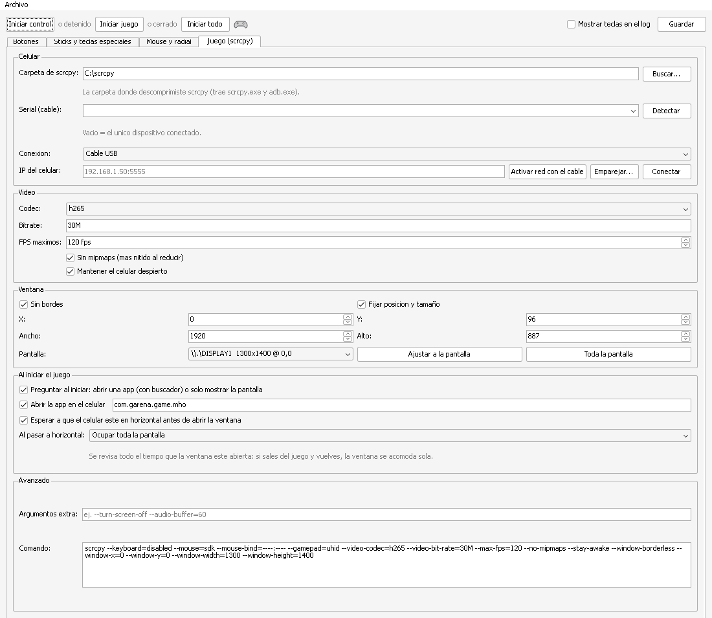
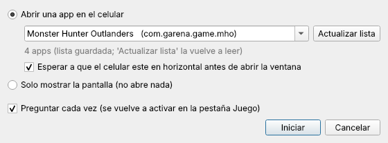

# Guía paso a paso: Windows

Al terminar vas a jugar en tu PC con teclado y mouse, el juego corriendo en tu celular y la
pantalla del celular apagada.

**Necesitas:** Windows 10 u 11 de 64 bits, un celular Android, un cable USB de datos (no solo de
carga) y un juego que acepte control.

---

## Parte 1. Preparar el celular (una sola vez)

1. **Activa las opciones de desarrollador.**
   Ajustes → *Acerca del teléfono* → toca 7 veces *Número de compilación*.
   En Xiaomi, POCO y Redmi es *Versión de HyperOS* (o *Versión de MIUI*).
2. **Activa la depuración USB.**
   Ajustes → *Opciones de desarrollador* → *Depuración USB*.
   En Xiaomi está en Ajustes → *Ajustes adicionales* → *Opciones de desarrollador*.
3. **Solo Xiaomi, POCO y Redmi:** en esa misma pantalla activa también
   **Depuración USB (Configuración de seguridad)**.
   - Te pide iniciar sesión con tu cuenta Xiaomi y, a veces, tener SIM y datos activos.
   - Reinicia el celular después de activarla.
   - Sin esta opción el mouse no puede tocar en los menús y el log muestra un error de
     `INJECT_EVENTS`.
4. **Instala el juego** desde la Play Store del celular y ábrelo una vez para que termine de
   descargar sus datos.
5. **Conecta el celular por USB** a la PC. En el celular, en la notificación de USB, elige
   *Transferencia de archivos*. Cuando aparezca **"¿Permitir depuración USB?"**, marca
   *Permitir siempre desde esta computadora* y acepta.

## Parte 2. Instalar en la PC (una sola vez)

1. **Descarga kb2pad-dock.**
   En [Releases](https://github.com/cHeRaZ-edu/kb2pad-dock/releases) baja
   `kb2pad-dock-v0.5.2-windows-x64.zip` y **descomprímelo** (por ejemplo en `C:\kb2pad-dock`).
   No lo abras desde dentro del zip.
2. **Descarga scrcpy.**
   En [scrcpy Releases](https://github.com/Genymobile/scrcpy/releases) baja el zip
   `scrcpy-win64-…` (versión 2.7 o más reciente) y descomprímelo (por ejemplo en `C:\scrcpy`).
   Esa carpeta trae `scrcpy.exe` y `adb.exe`.
3. **Abre `kb2pad.exe`.**
   Si Windows SmartScreen dice *"Windows protegió su PC"*: clic en *Más información* →
   *Ejecutar de todas formas*. Aparece porque el `.exe` no está firmado.
4. **Instala el driver del control virtual.**
   En la app: **Archivo → Instalar ViGEmBus**. Acepta los permisos de administrador y sigue el
   instalador. Es una sola vez.

## Parte 3. Configurar (una sola vez)

Todo esto se hace en la pestaña **Juego (scrcpy)**:

1. **Carpeta de scrcpy**: clic en *Buscar…* y elige la carpeta donde descomprimiste scrcpy.
2. **Serial (cable)**: clic en *Detectar*. Debe aparecer tu celular. Si no aparece, revisa el
   cable, la depuración USB y el aviso de "¿Permitir depuración USB?" en el celular.
3. **Pantalla** → elige tu monitor → **Toda la pantalla**. Con *Al pasar a horizontal* en
   *Ocupar toda la pantalla* (viene así), la ventana se acomoda sola cada vez que el celular gira,
   aunque salgas del juego y vuelvas.
4. Clic en **Guardar** (o `Ctrl+S`).

La app que se abre en el celular se elige al iniciar (Parte 4), con un buscador; ya viene
Monster Hunter Outlanders (`com.garena.game.mho`).

Los controles se cambian en la pestaña **Botones** (doble clic en una fila para editarla).
Cualquier cambio que guardes se aplica al momento, aunque el control esté corriendo.

## Parte 4. Jugar

1. Con el celular conectado, clic en **Iniciar todo**. La app:
   - inicia el control virtual,
   - te pregunta si **abrir una app** (escribe para buscarla entre las instaladas) o **solo
     mostrar la pantalla**,
   - abre la app en el celular y espera a que gire a horizontal,
   - y abre la ventana sin bordes del juego, del tamaño de la pantalla.

   
2. En el juego, revisa que aparezcan los íconos de botones de control (A, B, LT…). Eso confirma
   que el juego ve el control.
3. **Bloq Mayús** activa el **mouse como cámara**: el mouse mueve el stick derecho, el cursor
   se oculta sobre el juego y la rueda manda D-pad ← / →. Presiónalo otra vez para
   soltar el mouse (en menús, por ejemplo).
4. **F12** pausa kb2pad. Úsalo cuando vayas a escribir en otra ventana, porque kb2pad lee el
   teclado aunque la ventana del juego no tenga el foco. `Alt + Tab` no manda nada al juego.
5. **Chat**: abre el chat en el juego y presiona **Alt + T**. El icono de la bandeja cambia a un
   teclado: lo que escribes en la ventana del juego llega al celular y las letras ya no disparan
   botones; el mouse sigue funcionando. Android no saca su teclado en pantalla porque la ventana
   se conecta como teclado físico. Para volver: **Alt + 1/2/3** o **Alt + Q** (regresa al modo que
   tenías). Mientras juegas, kb2pad no deja que las teclas lleguen al celular.
   - **La primera vez**, con el juego abierto, pulsa **Idioma del teclado en el celular...** en
     *Sticks y teclas especiales* y en el celular elige el teclado **scrcpy** → *Español
     (Latinoamérica)*, para que salgan la `ñ` y los acentos.
   - En el chat solo cuenta el Alt izquierdo (`AltGr + Q` escribe `@`).

**Modos por arma**: cambia en plena partida con **Alt + 1** (Espada), **Alt + 2** (Ballesta)
o **Alt + 3** (Arco). El icono del modo actual (espada, ballesta o arco) se ve en la bandeja del
sistema y en la barra de la app; sale en gris si el control está detenido o en pausa. Cada modo es
una plantilla completa que editas en la pestaña **Botones** (elige el modo arriba); ahí también
cambias su icono por una imagen tuya.

Si no ves el icono junto al reloj, abre la flecha **^** de la barra de tareas y arrastra el
icono de kb2pad-dock a la barra para dejarlo siempre visible.

La tabla de controles y de modos está en el [README](../README.md#controles-por-defecto).

**Si sientes retraso en la imagen**: en la pestaña *Juego (scrcpy)* pon *Codec* `h264`,
*Resolución máxima* `1920` y, en *Codificador*, pulsa *Buscar codificadores* y elige uno de
hardware. Para ir más allá está *Optimización del codificador (avanzado)* con el botón
**Bajar latencia (automático)**; viene apagada y te muestra sus advertencias antes de aplicar
(ver el [README](../README.md#bajar-el-retraso-del-video)).

**Perfiles y temperatura**: en *Video* eliges un perfil (Mejor calidad, Balanceado, Rendimiento o
Máximo rendimiento) y con **Alt + P** alternas entre dos en plena partida. Mientras juegas, kb2pad
lee la temperatura del celular: la ves en el HUD encima del juego (donde también puedes poner los FPS
del juego, la batería, el procesador, la GPU y el modelo, con el orden, estilo y colores que quieras),
en la barra de la app y en un icono de la bandeja; te avisa con una notificación al llegar a crítico y, en peligro, cierra la
transmisión. Se ajusta en la pestaña **Temperatura y HUD** (ver el
[README](../README.md#temperatura-y-hud)).

## Parte 5. Apagar la pantalla del celular

scrcpy tiene la opción `--turn-screen-off`, pero en algunos celulares (por ejemplo con HyperOS)
también apaga la imagen que se transmite y la ventana queda en negro. Lo que sí funciona es el
atajo de scrcpy **una vez que el juego ya está en pantalla**:

1. Con el juego ya visible, haz clic en la ventana del juego para que tenga el foco.
2. Presiona **Alt + O**. La pantalla del celular se apaga y el juego sigue en la ventana.

Para volver a prenderla: **Alt + Shift + O**.

Mientras Alt está presionado, kb2pad no manda nada al juego, así que la `O` (que es `RT`) no
llega al juego. Si desactivaste esa opción en *Sticks y teclas especiales*, pausa antes con
**F12** y reanuda después.

Si con `Alt + O` la ventana también se pone negra, prende la pantalla con `Alt + Shift + O` y, en
su lugar, baja el brillo del celular al mínimo.

## Parte 6. Jugar sin cable (opcional)

1. En la pestaña **Juego (scrcpy)**, con el celular **conectado por cable** y en el mismo Wi-Fi que
   la PC, clic en **Activar red con el cable**. La app activa adb por Wi-Fi, lee la IP del celular
   y se conecta; *Conexión* cambia a **Red (Wi-Fi)**.
2. Clic en **Guardar** y desconecta el cable.
3. **Iniciar todo** como siempre: la app se conecta sola a esa IP.

Sin cable desde el principio (Android 11+): en el celular, *Opciones de desarrollador →
Depuración inalámbrica → Vincular dispositivo con código*, y en la app **Emparejar...** con la IP,
el puerto y el código que muestra el celular; en *Conectar a* va la IP y el puerto de la pantalla
principal de Depuración inalámbrica.

Por Wi-Fi el video tiene más retraso: usa una red de 5 GHz y baja el **Bitrate** a 8M–16M. Si el
celular se reinicia, repite el paso 1. Para volver al cable: *Conexión* = **Cable USB**. Si
Windows pregunta por el firewall al conectar, permite el acceso a `adb.exe` en redes privadas.

## Parte 7. Terminar

- **Cerrar juego** cierra la ventana de scrcpy (el juego sigue abierto en el celular).
- **Detener control** quita el control virtual.
- Al cerrar la app se cierran los dos.

---

## Problemas comunes

| Qué pasa | Qué hacer |
|---|---|
| Al iniciar el control dice que falta ViGEmBus | **Archivo → Instalar ViGEmBus** y vuelve a iniciar el control. |
| *Detectar* no muestra el celular | Revisa el cable de datos, la depuración USB y acepta el aviso en el celular. Prueba otro puerto USB. |
| El log de scrcpy dice `INJECT_EVENTS` | Xiaomi/POCO/Redmi: activa *Depuración USB (Configuración de seguridad)* y reinicia el celular. |
| El juego no reacciona al teclado | Revisa que el control esté **activo** (no en pausa con F12) y que el juego muestre íconos de control. scrcpy debe ser 2.7 o más reciente. |
| Los botones laterales del mouse no hacen nada | Activa *Mostrar teclas en el log*, presiónalos y mira qué código aparece. Asígnalo en la pestaña Botones con *Capturar*. |
| En el chat no se escribe nada | Activa *Mandar lo que escribo al celular* en *Sticks y teclas especiales* y vuelve a abrir el juego (el teclado se pone al abrir la ventana). En Linux instala `xdotool`. |
| Jugando, las teclas hacen cosas raras en el celular | Desactiva *Mandar lo que escribo al celular* y vuelve a abrir el juego, y abre un issue en el repo con lo que pasó. |
| En el chat salen símbolos en vez de `ñ` o acentos | Falta el idioma del teclado *scrcpy* en el celular: botón *Idioma del teclado en el celular...* con el juego abierto. |
| En red no conecta | Celular y PC en la misma red. Si el celular se reinició, conecta el cable y usa *Activar red con el cable* otra vez. |
| La ventana no queda donde esperas | Si tu Windows tiene escalado distinto de 100 %, ajusta X, Y, Ancho y Alto a mano en la pestaña Juego. |
| SmartScreen o el antivirus bloquean `kb2pad.exe` | El `.exe` no está firmado y usa hooks de teclado para leer las teclas. Puedes revisar el código en este repo o compilarlo tú mismo (ver el README). |
